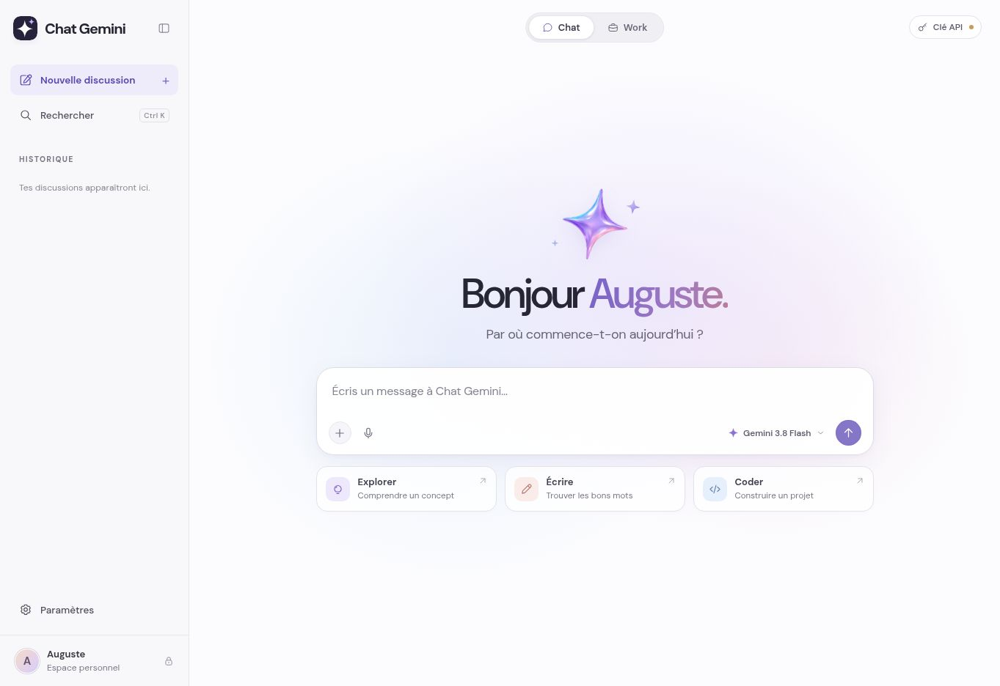

# Chat Gemini

Un chat personnel en français, avec la barre latérale de ChatGPT et un accueil inspiré de Gemini. Le menu à droite de la zone de saisie permet de changer de modèle entre deux messages d’une même discussion.

## Déployer sur Vercel

1. Ouvre la [page de création de projet Vercel](https://vercel.com/new).
2. Dans **Import Git Repository**, sélectionne **augustecolantonio6-netizen/chat-gemini** et clique sur **Import**.
3. Garde la branche **main**, la racine du dépôt et le préréglage **Other**. La configuration incluse sert le dossier `public` et déploie la fonction `/api/chat`. La commande de build est vide.
4. Clique sur **Deploy**. Aucune variable d’environnement n’est nécessaire.
5. Sur ton site, clique sur **Clé API** en haut à droite ou sur **Paramètres**. Colle ta clé Gemini et clique sur **Enregistrer**. Tu peux obtenir une clé dans [Google AI Studio](https://aistudio.google.com/apikey).
6. Choisis ton modèle dans la zone de saisie et envoie ton premier message.

## Modèles du sélecteur

| Nom affiché | Identifiant envoyé à Google |
| --- | --- |
| Gemini 3.8 Flash | `gemini-3.8-flash` |
| Gemini 3.7 Flash | `gemini-3.7-flash` |
| Gemini 3.5 Flash Lite | `gemini-3.5-flash-lite` |
| Gemini 3.1 Pro Preview | `gemini-3.1-pro-preview` |
| Gemini 3.1 Flash Lite | `gemini-3.1-flash-lite` |

La disponibilité dépend du projet Google associé à ta clé. Si Google refuse le modèle, tu peux en sélectionner un autre et cliquer sur **Réessayer** en conservant la question et son contexte.

## Utiliser le chat

- **Chat** sert aux échanges libres. **Work** demande à Gemini de structurer les tâches complexes en étapes et de produire un résultat utilisable.
- **Entrée** envoie le message. **Maj + Entrée** ajoute une ligne. Pendant la génération, le bouton d’envoi permet d’arrêter la réponse.
- Le bouton **+** accepte les images PNG, JPEG et WebP, les PDF et les fichiers texte ou Markdown. Chaque fichier peut peser jusqu’à 2 Mio. L’ensemble du contexte transmis est limité à 4 Mo après encodage.
- La dictée utilise la reconnaissance vocale du navigateur lorsqu’elle est disponible. **Ctrl + K** (ou **⌘ K**) recherche dans les titres et le texte des conversations.

## Clé et historique

Les conversations et leurs pièces jointes sont conservées dans IndexedDB sur le navigateur utilisé. À chaque envoi, le site transmet le contexte de la conversation à sa fonction Vercel, qui le relaie vers l’API Gemini de Google. La fonction transmet les réponses en continu et ne journalise ni le contenu ni la clé.

Par défaut, la clé est conservée dans la session de l’onglet. **Mémoriser sur cet appareil** la conserve dans le stockage local du navigateur jusqu’à ce que tu choisisses **Oublier la clé**. Chaque visiteur utilise sa propre clé.

## Lancer en local

Avec Node.js 22 ou plus récent, lance `npm run dev` à la racine et ouvre [localhost:3000](http://localhost:3000). Le site et la fonction API tournent ensemble, sans dépendances à installer.

`npm test` exécute les tests avec des réponses Google simulées. Ils couvrent les cinq identifiants, le contexte des fichiers et des messages, le streaming et les erreurs de clé, de modèle ou de quota.

La police [DM Sans](https://github.com/googlefonts/dm-fonts) est distribuée sous [licence SIL Open Font License](public/assets/OFL-DM-Sans.txt).
